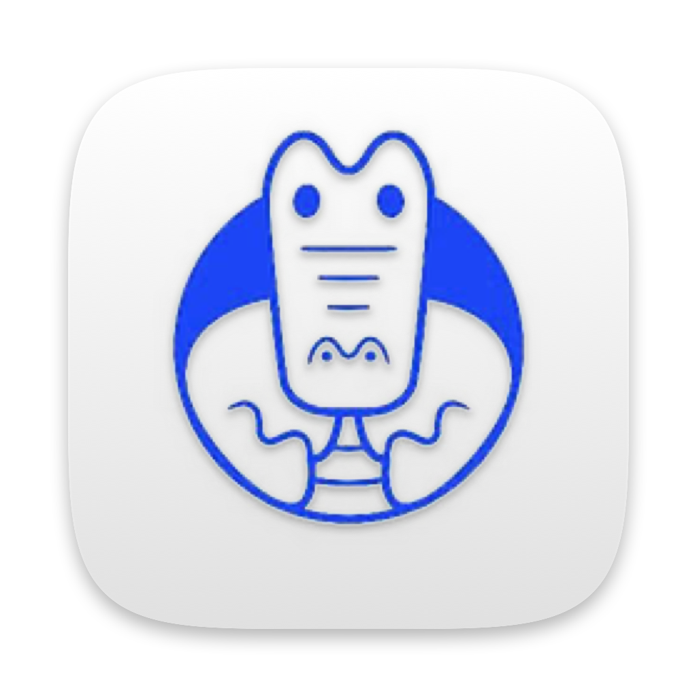
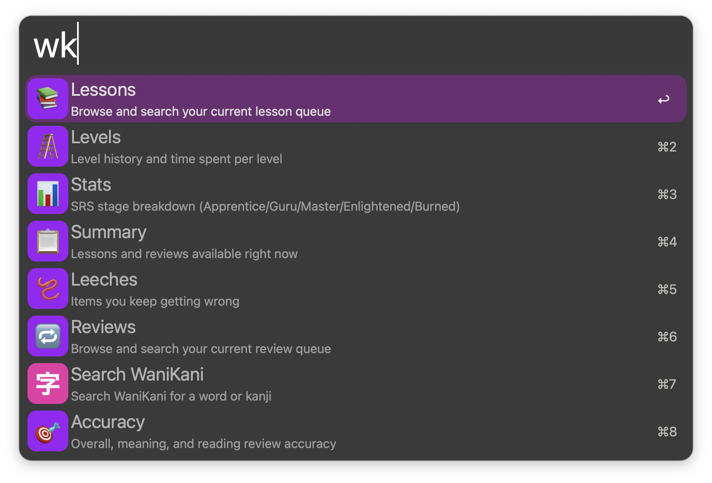
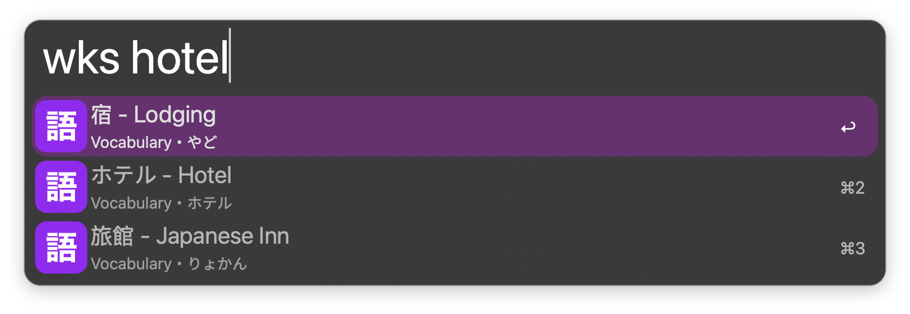
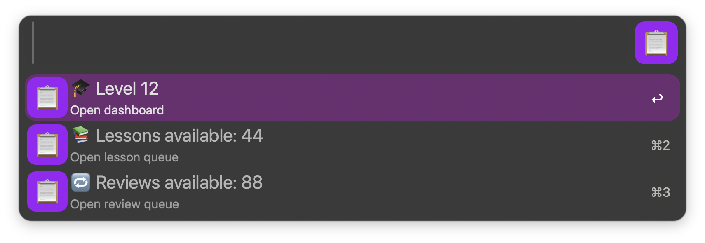

<p align="center">
  
</p>

<h1 align="center">WaniKani for Alfred</h1>

<p align="center">Check WaniKani progress and search subjects from Alfred.</p>

<p align="center">
  <a href="https://github.com/aleksgorbenko/alfred-workflow-wanikani/actions/workflows/ci.yml"></a>
  <a href="https://github.com/aleksgorbenko/alfred-workflow-wanikani/releases/latest"></a>
  <a href="LICENSE"></a>
  
  <a href="https://www.alfredapp.com/powerpack/"></a>
</p>

<p align="center">
  <a href="#commands">Commands</a> ·
  <a href="#install">Install</a> ·
  <a href="#development">Development</a>
</p>

Check WaniKani progress and search WaniKani subjects from Alfred.

## Commands

| Keyword | Function |
| --- | --- |
| `wk` | Browse lessons, reviews, level history, SRS statistics, accuracy, and leeches. |
| `wks` | Search WaniKani radicals, kanji, and vocabulary as you type. Select a result to open its WaniKani page. |

- `wk <page>` opens a page: `summary`, `levels`, `stats`, `accuracy`, `leeches`, `lessons`, `reviews`.
- Text after the page filters its rows, e.g. `wk lessons 水`.
- Delete the page name to go back to the menu.
- Pages load in the background: `Loading <page>…` shows until the data arrives, then cached pages open instantly.
- First row on every page is the page itself: `↩` opens the dashboard, `Tab` goes back.
- `Tab` on Lessons or Reviews available in Summary opens that queue.





Open the Summary view to see your current WaniKani progress.



### Maintenance

- `:wk` - cache size (`↩` reveals the folder) and Empty Cache.

## Install

1. Download the latest `WaniKani.alfredworkflow` from [Releases](https://github.com/aleksgorbenko/alfred-workflow-wanikani/releases).
2. Double-click it and let Alfred import it.
3. Requires [Alfred](https://www.alfredapp.com) with a Powerpack licence.

## Development

- Python 3.14, standard library only.
- Runtime code is in `src/wkapi/`.
- Maintainer tools are in `tools/`.

```sh
make setup   # install dev tools and the Python environment
make ci      # everything CI runs
make check   # lint, format check, and tests
make build   # package dist/WaniKani.alfredworkflow
make verify  # audit the built bundle
make release VERSION=v1.0.0
make sync-plist WORKFLOW_DIR=/path/to/installed/workflow
make link-live WORKFLOW_DIR=/path/to/installed/workflow
```

## My Other Workflows

- [BunPro for Alfred](https://github.com/aleksgorbenko/alfred-workflow-bunpro)
- [Nihongo for Alfred](https://github.com/aleksgorbenko/alfred-workflow-nihongo)
- [Netlify for Alfred](https://github.com/aleksgorbenko/alfred-workflow-netlify)
- [2Do for Alfred](https://github.com/aleksgorbenko/alfred-workflow-2do)
- [Discogs for Alfred](https://github.com/aleksgorbenko/alfred-workflow-discogs)
- [Bandcamp for Alfred](https://github.com/aleksgorbenko/alfred-workflow-bandcamp)
- [config](https://github.com/aleksgorbenko/config)
